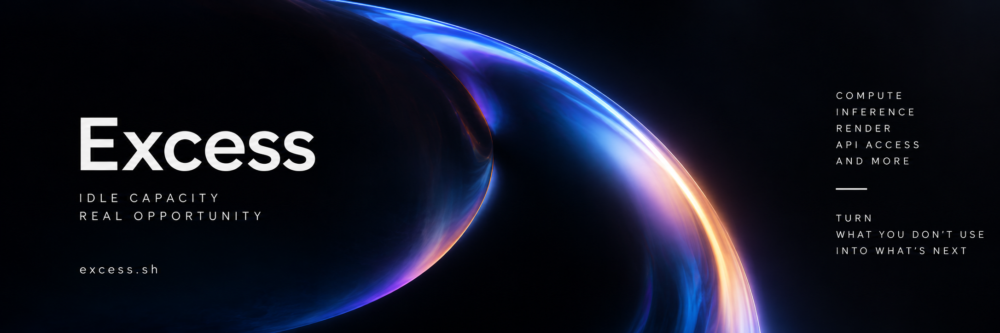

# Excess Worker

Run selected AI models on your computer and supply inference capacity through [Excess](https://excess.sh), with local controls over when and how your machine works.

**Excess Worker 0.2.3 (sequence 32) · [Windows x64 download](https://github.com/excesssh/Excess-Worker/releases/download/v0.2.3/excess-worker-0.2.3-eae9de12849a-win-x64.zip) · [Linux x64 download](https://github.com/excesssh/Excess-Worker/releases/download/v0.2.3/excess-worker-0.2.3-eae9de12849a-linux-x64.tar.gz)**

The published [0.2.2](https://github.com/excesssh/Excess-Worker/releases/tag/v0.2.2), [0.2.1](https://github.com/excesssh/Excess-Worker/releases/tag/v0.2.1), [0.2.0](https://github.com/excesssh/Excess-Worker/releases/tag/v0.2.0) and [0.1.0](https://github.com/excesssh/Excess-Worker/releases/tag/v0.1.0) releases, the anonymous project key and their evidence remain unchanged and available as historical release records.

**Service status (10 October 2026): the hosted Excess exchange is offline.** Pairing, marketplace access, buyer jobs and earnings require that service and are currently unavailable. Worker packages and source remain available here; local use still requires an installed model and follows the limits documented below.

**Linux NVIDIA CUDA in 0.2.3:** All 17 pinned local catalogue models passed actual buyer jobs on one recorded NVIDIA B300 configuration (driver 580.178.04, CUDA 12.9, Ubuntu kernel 7.0.0-38-generic) under the `linux-cuda-device-budget-v2` GPU helper. The same runs passed drain, restart, revocation and cleanup checks. Cancelled text, image, transcription and embedding jobs ended with no charge; on the B300, runtime-monitor evidence covers transcription and embedding only. Every text stream, including gpt-oss, completed through the buyer SDK, with the buyer near the coordinator. GPU memory budgets are sampled whole-device limits, not hard VRAM partitions. Other GPUs, drivers and distributions are unverified. See the [B300 record](docs/verification/linux-b300-cuda-sequence31.md) and the [Linux CUDA status](docs/verification/linux-cuda-status.md).

**Known 0.2.3 Windows faults:** a job whose prompt or streamed output contains non-ASCII characters fails; a warm runtime can be stopped mid-job once the job time limit has passed since the runtime started; and the worker stops after a failed job until it is restarted. Fixes are on `main` for the next release. The same Windows tests confirmed that a buyer about 1.5 seconds away now receives the whole stream, and that cancelling a text or image job stops the runtime. See the [Windows streaming and cancellation record](docs/verification/windows-streaming-cancellation-0.2.3.md).

**Updating:** drain the worker, then run `excess-worker update`; Windows and Linux 0.2.2 installations update to 0.2.3. The 0.2.0 Linux updater accepts only the earlier GPU helper profile, so upgrade Linux 0.2.0 by installing 0.2.3 over the same location with the verified installer ([steps](docs/INSTALLATION.md#stop-revoke-and-update)).

**[Verify your download →](docs/VERIFICATION.md#verify-your-download)** Establish the trusted project key, verify the release signature, then check your archive before installing. [0.2.3 release files](https://github.com/excesssh/Excess-Worker/releases/tag/v0.2.3) · [Installation guide](docs/INSTALLATION.md)

## Trust and machine protection

- **Public source.** Inspect the worker and build it yourself. [Source and build instructions](docs/BUILD.md).
- **Project-signed downloads.** Minisign authenticates the release manifest; its signed hashes identify the exact archives. [Key and verification commands](docs/VERIFICATION.md#verify-your-download).
- **Reproducible packages.** The two independent sequence-32 builds produced identical Windows and Linux packages. This covers assembled packages, not independent rebuilds of upstream binaries, operating systems or drivers. The earlier [0.1.0](https://github.com/excesssh/Excess-Worker/releases/download/v0.1.0/reproducibility.json), [sequence-26](https://github.com/excesssh/Excess-Worker/releases/download/v0.2.0/reproducibility.json), [sequence-28](https://github.com/excesssh/Excess-Worker/releases/download/v0.2.1/reproducibility.json) and [sequence-30](https://github.com/excesssh/Excess-Worker/releases/download/v0.2.2/reproducibility.json) comparison reports apply only to those packages. [Build scope](docs/BUILD.md#reproducibility-and-release-status) · [sequence-32 comparison report](https://github.com/excesssh/Excess-Worker/releases/download/v0.2.3/reproducibility.json).
- **Scoped machine credentials.** A revocable device key signs worker messages. It cannot authorize wallet spending or withdrawals, and the model runtime never receives it. [Credential handling](SECURITY.md#sensitive-local-data).
- **Restricted model access.** Selected model/runtime files are read-only, scratch is private, and direct network access is denied. Downloads require explicit model/runtime and licence consent. [Security boundaries](SECURITY.md#model-runtime-boundaries) · [model consent](docs/MODELS.md).
- **Control and authenticated updates.** Set resource limits, drain or stop work, and revoke a device. The published 0.1.0 release passed its update and recovery checks. Sequence-26 Linux direct installation and update/recovery passed; Windows direct installation, authenticated update, and CPU/CUDA recovery passed. Candidate25 buyer jobs are separately identified, with sequence-26 execution payload matches recorded. Sequence 28 passed a signed Windows update from 0.2.0 plus downgrade and tampered-archive refusal on Windows and Linux. Sequence 30 passed signed updates from 0.2.1 and sequence 32 from 0.2.2, each on Windows and Linux, plus downgrade and tampered-archive refusal; Linux 0.2.0 installations upgrade with the installer. [Supplier controls](docs/OPERATIONS.md#local-controls) · [update and recovery evidence](docs/VERIFICATION.md#updates-and-recovery).

A valid signature establishes that the release was signed by the holder of the trusted **project key**, and that its authenticated contents have not changed. It does not establish a verified legal publisher, an independent security audit or guaranteed safety. Windows executables have **no trusted Authenticode publisher signature**; read the [Windows warning guidance](docs/INSTALLATION.md#windows-publisher-warnings) before running them.

## Start supplying

1. **Download.** Choose the platform archive plus `release.json` and `release.json.minisig` from its [release page](https://github.com/excesssh/Excess-Worker/releases/tag/v0.2.3). Packages include Node; suppliers do not need npm or a source build.
2. **Verify.** Follow [Verify your download](docs/VERIFICATION.md#verify-your-download), including establishing the trusted key. The website's file checker compares hashes; it does **not** verify a release signature.
3. **Install.** Use the [verified offline installer commands](docs/INSTALLATION.md#install-the-verified-package) as your ordinary user. Add the installed launcher to your session's PATH, then run `excess-worker guide` and `excess-worker doctor`.
4. **Pair.** Run `excess-worker pair https://excess.sh "my-worker"`. On the [Supply page](https://excess.sh/supply), sign in, choose **Add a machine**, then **Next: pair your machine**. Enter the CLI code and compare the fingerprint; approve only if they match, then return to the CLI and run `excess-worker complete-pairing`. Wallet approvals happen on the website.
5. **Choose a model.** Run `excess-worker models`, select `excess-worker use qwen3-4b --cpu`, then review `excess-worker model-plan`. Read the listed licences and download sizes before [accepting the model/runtime installation](docs/INSTALLATION.md#choose-and-install-a-model).
6. **Supply capacity.** Set your resource policy and supplier price, then start work: `excess-worker run` on Windows, or the bounded user service on Linux. [Exact commands and price units](docs/INSTALLATION.md#supply-capacity). Check progress and earnings on the Supply page. Availability does not guarantee demand or earnings.

## Models you can choose

The local catalogue has **13 text models and four media models**, with pinned files and licences.

| Task | Available catalogue entries |
| --- | --- |
| Text | Qwen3 4B, 8B, 14B, 30B-A3B, 32B, Coder 30B-A3B and Instruct 2507; Phi-4 mini and Phi-4; Llama 3.1 8B and Llama 3.3 70B; gpt-oss 20B and 120B. |
| Embeddings | Qwen3 Embedding 0.6B. |
| Transcription | Qwen3 ASR 0.6B. |
| Images | SD-Turbo and FLUX.1 schnell. |

**[Complete catalogue: sizes, memory, quantization, licences and installation steps](docs/MODEL-CATALOG.md)** Run `excess-worker models` to see every local entry and its estimated fit. As of 7 October 2026, the source catalogue contains 43 hosted-provider entries as a separate service; they cannot be installed on a worker. This count can change independently of the 17 pinned local models.

Catalogue availability is broader than verified execution. The table records buyer jobs run by the signed 0.2.3 candidate (sequence 31), whose Windows and Linux payloads equal published sequence 32, and earlier published evidence. Each route listed for 0.2.3 completed a funded testnet buyer job with a checked answer, a verified final signature and accounting, plus drain, restart, revocation and cleanup.

Published 0.2.0 also passed [Qwen3-8B](docs/verification/qwen3-8b-windows-cpu.md) and [Qwen3-14B](docs/verification/qwen3-14b-windows-cpu.md) Windows CPU and [Phi-4-mini Windows CPU and CUDA](docs/verification/phi4mini-windows.md) buyer lifecycles. The 0.2.3 Windows and Linux CPU routes beyond the release gates are listed in the [0.2.3 model route record](docs/verification/candidate31-other-models.md); the [0.2.2 record](docs/verification/candidate29-other-models.md) covers that release.

## Your machine, your controls

Choose the model, price, CPU threads, memory budget and operating schedule. Battery pauses and temperature limits depend on available telemetry. Windows CUDA has a separate sampled GPU memory watchdog; it is not a hard VRAM reservation or hardware partition. Use `excess-worker drain` to finish the current attempt without taking new work, or `excess-worker stop-now` to request immediate shutdown. Revoke a device on the Supply page to remove its coordinator access. [Controls, stopping and revocation](docs/OPERATIONS.md).

| Configuration | 0.2.3 recorded buyer execution | Earlier published evidence |
| --- | --- | --- |
| Windows x64 CPU | Qwen3-4B, Qwen3 Embedding 0.6B, Qwen3 ASR 0.6B, SD-Turbo, Phi-4-mini, Qwen3-8B, Llama 3.1 8B, Phi-4, Qwen3-14B and gpt-oss-20b, each with a funded job and a cancellation; host memory budgets 4.25–12.5 GiB. | 0.2.0: Qwen3-8B, Qwen3-14B and Phi-4-mini. 0.1.0: Qwen3-4B. |
| Windows x64 NVIDIA CUDA | Qwen3-4B, Qwen3 Embedding 0.6B, Qwen3 ASR 0.6B, SD-Turbo, Phi-4-mini, Qwen3-8B and Llama 3.1 8B on the recorded RTX 3070 Ti 8 GiB, driver 596.49: 6 GiB GPU budget (Qwen3-8B and Llama 3.1 8B 6.5 GiB), each with a funded job and a cancellation. | 0.2.0: Phi-4-mini. 0.1.0: Qwen3-4B. |
| Linux x64 CPU (WSL2) | Qwen3-4B, Qwen3-8B and Qwen3-14B on Linux 6.18.54.1 WSL2, Ubuntu 24.04: two threads, 8, 7 and 11 GiB memory maximum, zero swap, 64 tasks, CPU 200%. | 0.2.0: Qwen3 Embedding 0.6B and Qwen3 ASR 0.6B ([record](docs/verification/linux-cpu-sequence26.md)), Qwen3-8B ([record](docs/verification/qwen3-8b-linux-wsl-cpu.md)). 0.1.0: Qwen3-4B. |
| Linux x64 NVIDIA CUDA | All 17 pinned local models on one NVIDIA B300 (driver 580.178.04, CUDA 12.9, Ubuntu kernel 7.0.0-38-generic), with sampled whole-device GPU budgets of 8–77 GiB. GPU cancellation ended with no charge for all four task types, with runtime-monitor evidence for transcription and embedding. [B300 record](docs/verification/linux-b300-cuda-sequence31.md). Other GPUs are unverified. | 0.2.2: the same 17 models ([record](docs/verification/linux-b300-cuda-sequence29.md)). No Linux GPU claim in 0.2.1, 0.2.0 or 0.1.0. |

Version 0.2.3 reuses candidate31 buyer execution through verified unchanged executable payloads, and passed signed updates from 0.2.2 on Windows and Linux. The original intermittent CUDA incident's cause remains unestablished; the separate native admission fix and five successful repeat jobs are scoped evidence. [Execution and release evidence](docs/VERIFICATION.md#technical-release-evidence) · [Remaining model coverage](docs/verification/remaining-work-checklist.md).

## For developers

The standalone npm workspace contains the worker, adapters and protocol. Coordinator services, custody and settlement signing are maintained separately.

Use Node **24.11.1**, npm **11.7.0** and the committed lockfile. Use `npm.cmd` in Windows PowerShell.

```sh
npm ci --ignore-scripts
npm run build
npm test
```

[Build and packaging](docs/BUILD.md) · [Architecture](docs/ARCHITECTURE.md) · [Contributing](CONTRIBUTING.md) · [Source history](docs/HISTORY.md) · [MIT licence](LICENSE)

Found a security issue? Use [GitHub private vulnerability reporting](https://github.com/excesssh/Excess-Worker/security/advisories/new). Keep exploitable details out of public issues. [Security policy](SECURITY.md#reporting).
